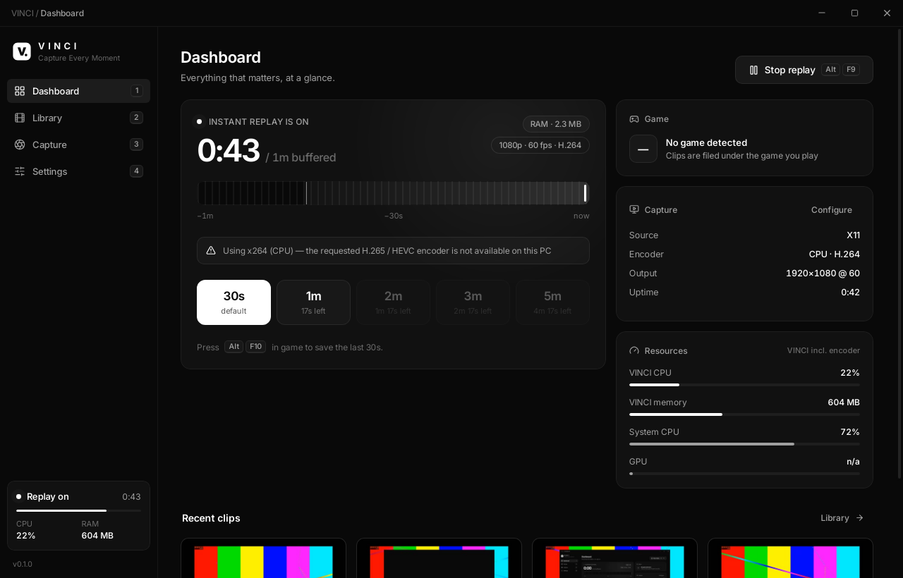
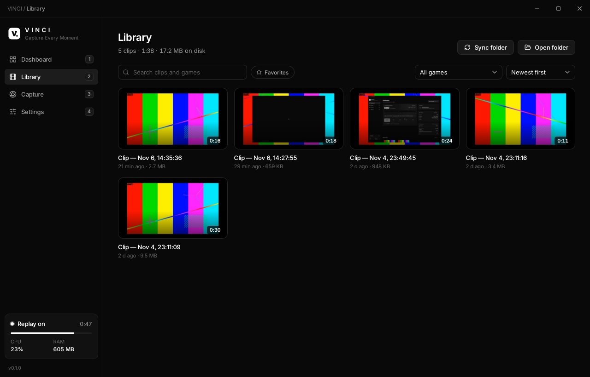
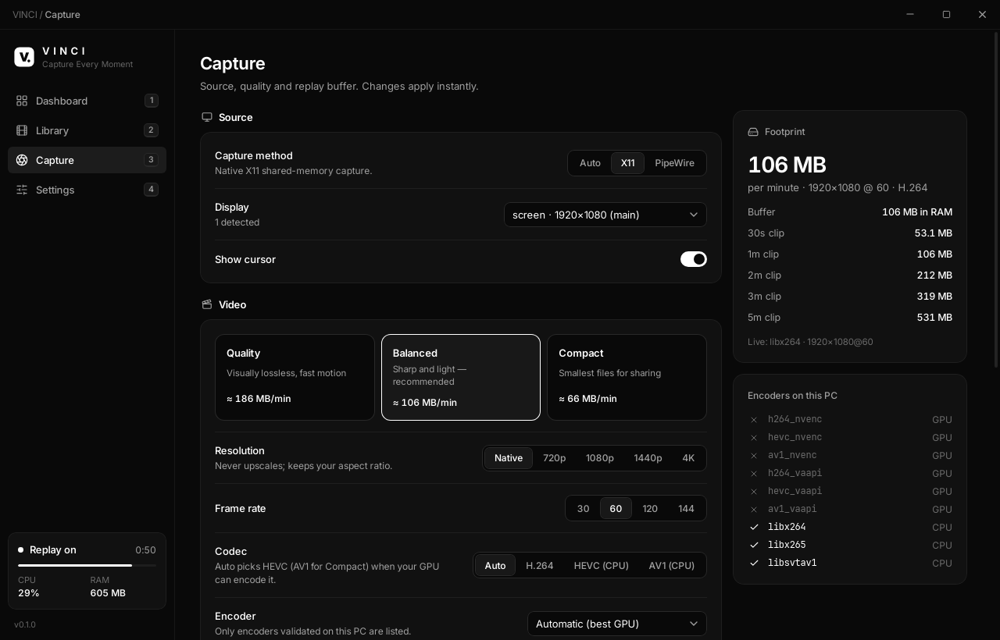
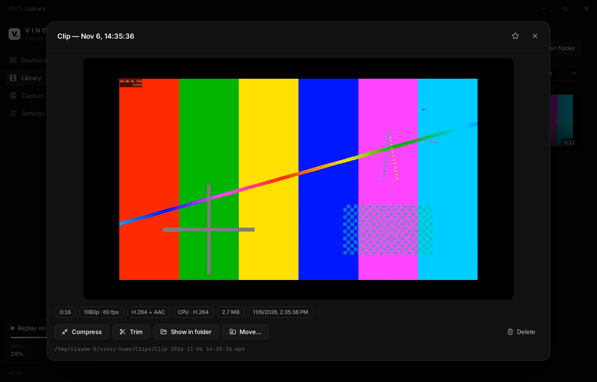

<div align="center">


# VINCI

**Capture Every Moment.**

Un enregistreur de replays instantanés léger pour les joueurs, sous Windows et Linux.
Buffer de replay encodé par le GPU, clip en une touche, aucun réencodage, aucun compte, aucun cloud.

[Installer](#installation) · [Fonctionnalités](#fonctionnalités) · [Compiler](#compiler-depuis-les-sources) · [Dépannage](#dépannage) · [English](README.md)

</div>

---

## Installation

**Linux** (Ubuntu, Debian, Mint, Pop!_OS, Fedora, openSUSE, Arch…) :

```bash
curl -fsSL https://github.com/tfem1/vinci/releases/latest/download/install.sh | bash
```

**Windows 10 / 11** (PowerShell, sans droits administrateur) :

```powershell
irm https://github.com/tfem1/vinci/releases/latest/download/install.ps1 | iex
```

> Ces commandes fonctionnent dès la publication de la première release (voir
> [docs/RELEASING.md](docs/RELEASING.md)). Une fois un domaine relié au site d'installation,
> la forme courte fonctionne aussi :
> `curl -fsSL https://<votre-domaine>/install.sh | bash` et `irm https://<votre-domaine>/install.ps1 | iex`
> (par exemple `vinci.app`, une fois ce domaine configuré).

Les deux scripts vérifient chaque téléchargement avant toute exécution : SHA-256, plus,
lorsqu'ils sont configurés, la signature Ed25519 de la liste des sommes de contrôle et
Authenticode. Les installateurs classiques sont sur la
[page Releases](https://github.com/tfem1/vinci/releases) : `VINCI-windows-x64-setup.exe`,
`.msi`, `.deb`, `.rpm`, `.AppImage`. Détails : [installers/README.md](installers/README.md).

Raccourci par défaut : **Alt+F10** sauvegarde les 30 dernières secondes. Les clips vont dans `Vidéos/VINCI`.

## Captures d'écran

| Dashboard | Bibliothèque |
|---|---|
|  |  |
| **Capture** | **Lecteur** |
|  |  |

*Captures réelles de VINCI sous Linux (bureau X11 virtuel, encodage CPU). La mention
« x264 (CPU) » est VINCI qui indique honnêtement que la machine de test n'a pas d'encodeur GPU.*

## Pourquoi VINCI

| | |
|---|---|
| **LÉGER** | Le moteur est un processus natif d'environ 12 Mo qui utilise moins de 1 % de CPU ; la capture et l'encodage tournent sur le moteur vidéo du GPU. L'interface est fermée quand VINCI est dans la zone de notification. Paquets Linux de 8 Mo. |
| **QUALITÉ** | Encodage matériel HEVC / AV1 avec un débit piloté par la qualité (CQ / ICQ / CRF) : mouvements nets pour une fraction des débits H.264 habituels. Trois profils : Quality, Balanced, Compact. |
| **INSTANTANÉ** | Sauvegardez les 30 dernières secondes, ou 1, 2, 3 ou 5 minutes (jusqu'à 10) d'une seule touche. Les clips sont découpés dans le buffer déjà encodé, sans réencodage, et enregistrés en environ une seconde. |
| **SIMPLE** | Une commande pour installer. Aucun compte, aucun cloud, aucune télémétrie. |

## Fonctionnalités

**Replay instantané**
- Buffer glissant de 15 s à 10 min, en RAM ou dans un anneau disque de taille fixe (≈ 0 RAM), choisi automatiquement.
- Sauvegarde de 30 s, 1, 2, 3 ou 5 min depuis le dashboard, la zone de notification, un raccourci par durée, ou `vinci --save-clip 60`.
- Le clip inclut l'instant où vous avez appuyé ; il est découpé sur les images clés et jamais réencodé.
- Résistant aux plantages : écritures atomiques, encodeur supervisé et relancé, buffer conservé après une relance, fichiers temporaires corrompus nettoyés au démarrage.

**Capture** : APIs natives, aucune injection (compatible anti-cheat)
- Windows : **Windows.Graphics.Capture** (écran ou fenêtre du jeu) et **DXGI Desktop Duplication** (plein écran exclusif). Les images restent sur le GPU (D3D11 vers NVENC/AMF sans copie, QSV via l'interop D3D11).
- Linux : **X11** (XShm) et **Wayland** via **xdg-desktop-portal + PipeWire** (écran choisi une fois, puis mémorisé).
- Son du jeu + micro (loopback WASAPI sous Windows, PulseAudio/PipeWire sous Linux), volume par source.

**Encodage et compression**
- H.264, HEVC et AV1 sur **NVIDIA NVENC, AMD AMF, Intel Quick Sync, VA-API**. Chaque encodeur est validé par un vrai encodage de test sur votre PC, avec repli automatique (x264 CPU en dernier recours).
- 720p / 1080p / 1440p / 4K (jamais d'agrandissement), 30 / 60 / 120 / 144 i/s.
- Compression d'un clip sur place : « Discord 10 Mo », « 50 Mo », « Compact AV1/HEVC », réduction en 1080p. Il reste toujours un seul fichier.
- Découpe sans perte.

**Bibliothèque**
- Un seul fichier physique par clip dans votre dossier (un sous-dossier par jeu en option). SQLite ne stocke que les métadonnées.
- Miniatures, lecteur intégré avec navigation, recherche, filtre par jeu, favoris, tri (date, taille, durée, nom), renommage (qui renomme aussi le fichier), déplacement, suppression, ouverture du dossier. Les fichiers ajoutés ou supprimés hors de VINCI sont détectés.

**Et aussi**
- Détection des jeux (≈ 85 jeux, plus les bibliothèques Steam/Epic/Riot/GOG, compatible Proton) : les clips sont nommés et rangés par jeu, avec une option pour ne bufferiser que pendant qu'un jeu tourne.
- Overlay en jeu discret (« Clip saved · 30s »), coin et opacité réglables.
- Utilisation CPU / RAM / GPU / encodeur en direct.
- Mode économie de ressources, priorité de capture, budget RAM.
- Mises à jour automatiques signées (stable / bêta) qui ne touchent jamais à vos clips ni à vos réglages.
- CLI sans interface (`vinci-cli`) qui utilise le même moteur.

## Fonctionnement

```
 Capture native (WGC / DDA / X11 / PipeWire)
        │  les images restent sur le GPU
        ▼
 Encodeur matériel (NVENC / AMF / QSV / VA-API) ──► flux MP4 fragmenté
        │
        ▼
 Buffer de replay VINCI : anneau aligné sur les GOP (RAM ou disque), N dernières secondes
        │  raccourci
        ▼
 Copie des fragments choisis → remux (-c copy, faststart) → renommage atomique → bibliothèque
```

Moteur en Rust (crates indépendantes), coque Tauri 2, interface React/TypeScript. FFmpeg et
GStreamer tournent comme processus auxiliaires supervisés. Conception détaillée :
[docs/ARCHITECTURE.md](docs/ARCHITECTURE.md).

## Compatibilité

| | État |
|---|---|
| Windows 11, Windows 10 1903+ (x64) | Pris en charge : WGC + DDA, NVENC / AMF / QSV. La 1809 fonctionne avec DDA uniquement. Sur ARM64, la version x64 tourne en émulation. |
| Ubuntu 22.04+, Debian 12+, Mint 21+, Pop!_OS | Pris en charge (`.deb`, X11 et Wayland) |
| Fedora 39+, openSUSE | Pris en charge (`.rpm`). Pour l'encodage matériel H.264/HEVC sous Fedora, utilisez le `ffmpeg` de RPM Fusion. |
| Arch / Manjaro / EndeavourOS / autres | Pris en charge (AppImage, l'installateur gère les dépendances) |
| GPU | NVIDIA (GTX 900+ ; l'AV1 demande une RTX 40), AMD (VCN ; l'AV1 demande une RX 7000), Intel (Quick Sync / VA-API ; l'AV1 demande Arc / Core Ultra). Sans encodeur GPU, VINCI se replie sur x264 en CPU. |

Ce qui a été vérifié, et comment : [docs/TESTING.md](docs/TESTING.md).

## Configuration

Tout se règle dans l'application (**Capture** et **Settings**). Les fichiers, au besoin :

| | Linux | Windows |
|---|---|---|
| Réglages | `~/.config/vinci/settings.json` | `%APPDATA%\VINCI\config\settings.json` |
| Index de la bibliothèque, logs | `~/.local/share/vinci/` | `%LOCALAPPDATA%\VINCI\data\` |
| Miniatures, anneau de replay | `~/.cache/vinci/` | `%LOCALAPPDATA%\VINCI\cache\` |
| Clips | `~/Vidéos/VINCI` | `Vidéos\VINCI` |

Ligne de commande (utilisable aussi depuis un raccourci du bureau ou un raccourci du compositeur) :

```bash
vinci --save-clip          # sauvegarde la durée par défaut
vinci --save-clip 120      # sauvegarde les 2 dernières minutes
vinci --toggle-replay      # démarre/arrête le buffer
vinci --minimized          # démarre dans la zone de notification
```

**Wayland :** VINCI enregistre ses raccourcis via le portail XDG GlobalShortcuts (KDE
Plasma, GNOME 48+, Hyprland…). Sur les bureaux qui ne l'ont pas, associez
`vinci --save-clip` à une touche dans les réglages clavier du bureau.

## Compiler depuis les sources

```bash
git clone https://github.com/tfem1/vinci.git
cd vinci
```

### Linux (Ubuntu/Debian)

```bash
sudo apt install -y build-essential curl libwebkit2gtk-4.1-dev libayatana-appindicator3-dev \
  librsvg2-dev libxdo-dev libssl-dev patchelf ffmpeg gstreamer1.0-plugins-good \
  gstreamer1.0-libav gstreamer1.0-pipewire
```

Fedora : `sudo dnf install webkit2gtk4.1-devel libappindicator-gtk3-devel librsvg2-devel libxdo-devel openssl-devel ffmpeg-free gstreamer1-plugins-good pipewire-gstreamer`
· Arch : `sudo pacman -S --needed webkit2gtk-4.1 libappindicator-gtk3 librsvg xdotool openssl ffmpeg gst-plugins-good gst-libav gst-plugin-pipewire base-devel`

Installez Rust (https://rustup.rs) et Node.js 20+, puis :

```bash
npm ci
npm run tauri dev                  # développement (rechargement à chaud)
npm run tauri build                # production : .deb, .rpm, .AppImage dans target/release/bundle/
cargo test --workspace             # plus de 70 tests, dont de vrais encodages FFmpeg
scripts/e2e-linux.sh               # test de bout en bout sur un bureau X11 virtuel (Xvfb, pulseaudio, xdotool)
cargo run -p vinci-cli -- detect   # sans interface : rapport matériel et encodeurs
```

### Windows

Installez [Rust](https://rustup.rs) (toolchain MSVC), [Node.js 20+](https://nodejs.org), les
Visual Studio Build Tools (« Développement Desktop en C++ ») et WebView2 (préinstallé sous
Windows 11). Puis dans PowerShell :

```powershell
npm ci
powershell -ExecutionPolicy Bypass -File scripts\fetch-ffmpeg.ps1   # FFmpeg 8.1 embarqué (prise en charge de WGC)
npm run tauri dev
npm run tauri build      # setup.exe NSIS + MSI dans target\release\bundle\
cargo test --workspace
```

## Dépannage

| Problème | Solution |
|---|---|
| « Using x264 (CPU) — encoder not available » | L'encodeur GPU a échoué à son encodage de test. Mettez à jour le pilote graphique. Sous Linux, vérifiez l'accès à `/dev/dri/renderD*` (`sudo usermod -aG render,video $USER`, puis reconnectez-vous) et installez le pilote VA-API (`intel-media-va-driver`, `mesa-va-drivers`). **Settings → Diagnostics** affiche l'erreur de chaque encodeur. |
| Wayland : « Wayland capture needs GStreamer with the PipeWire plugin » | Installez `gstreamer1.0-pipewire` (Debian/Ubuntu), `pipewire-gstreamer` (Fedora) ou `gst-plugin-pipewire` (Arch), ainsi que `xdg-desktop-portal` pour votre bureau. |
| Le raccourci ne fait rien | Une autre application l'utilise peut-être (c'est indiqué dans **Settings → Hotkeys**) : choisissez-en un autre. Sous Wayland sans le portail GlobalShortcuts, associez `vinci --save-clip` dans les réglages du bureau. |
| Jeu en plein écran non capturé sous Windows | Passez **Capture method** sur *Desktop Duplication* (qui capture le plein écran exclusif), ou jouez en fenêtré sans bordure. |
| Pas de son dans les clips | Vérifiez **Capture → Audio** (périphérique de sortie). Sous Linux, `pactl list short sources` doit afficher une source `.monitor`. Si le son est décalé, ajustez **Settings → Advanced → Audio offset**. |
| Le clip ne se lit pas dans VINCI | Utilisez « Open in player ». La lecture HEVC/AV1 dans l'application dépend de la webview du système (Windows demande les extensions vidéo HEVC/AV1). |
| L'AppImage ne démarre pas | Installez FUSE 2 (`libfuse2t64` sous Ubuntu 24.04, `fuse-libs` sous Fedora, `fuse2` sous Arch). |
| Autre problème | **Settings → Advanced → Open logs folder** (`vinci.log`) et **Diagnostics → Copy report**. |

## Confidentialité et sécurité

Aucun compte, aucune télémétrie, aucun cloud. La seule requête réseau est la vérification
quotidienne des mises à jour, qui peut être désactivée. Une mise à jour n'est installée que si
sa signature Ed25519 et son SHA-256 correspondent. Le buffer de replay vit en RAM ou dans un
fichier temporaire supprimé à la fermeture. VINCI n'injecte jamais de code dans les jeux.

## Organisation du projet

```
crates/            Moteur Rust : une crate par module
  vinci-hw/        détection du matériel et des capacités
  vinci-capture/   backends de capture (WGC, DDA, X11, PipeWire), WASAPI
  vinci-encoding/  encodeurs, profils, tests d'encodeurs, compression
  vinci-replay/    buffer circulaire fMP4 et export sans réencodage
  vinci-clips/     bibliothèque SQLite
  vinci-storage/   chemins, persistance atomique
  vinci-games/     détection des jeux
  vinci-hotkeys/   raccourcis globaux
  vinci-update/    mises à jour signées + outil de signature des releases
  vinci-engine/    orchestration (utilisée par l'application et la CLI)
  vinci-cli/       CLI sans interface
src-tauri/         coque de bureau (Tauri 2) : fenêtres, zone de notification, overlay, serveur média
src/               interface React + TypeScript (components, pages, hooks, styles)
installers/        install.sh, install.ps1, uninstall.ps1
scripts/           scripts de release, d'empaquetage, de test et d'installation
docs/              architecture, tests, releases
.github/workflows/ CI, release, montée de version, site d'installation
```

## Contribuer et publier

Les pull requests sont les bienvenues : lancez `cargo fmt`, `cargo clippy --workspace -- -D warnings`,
`cargo test --workspace` et `npm test`. Mainteneurs : voir [docs/RELEASING.md](docs/RELEASING.md)
(clés de signature, canaux stable/bêta, montée de version en un clic).

## Licence

[MIT](LICENSE). L'installateur Windows et l'AppImage embarquent FFmpeg (build GPL v3) en tant
que programme séparé : voir [THIRD_PARTY_NOTICES.md](THIRD_PARTY_NOTICES.md).
