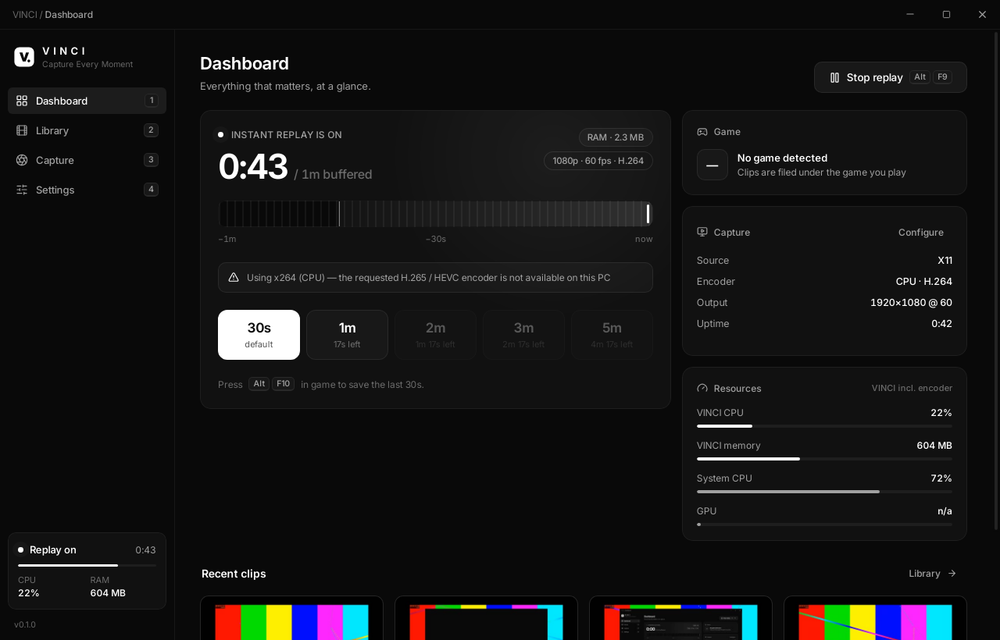
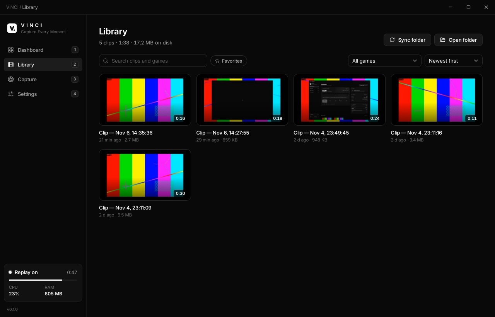
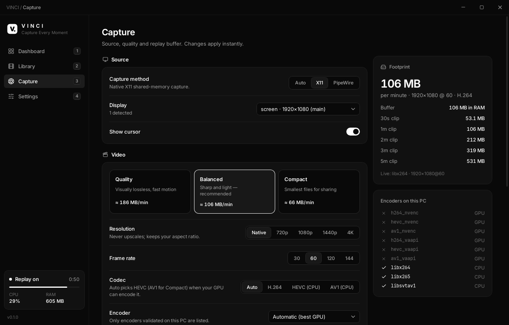
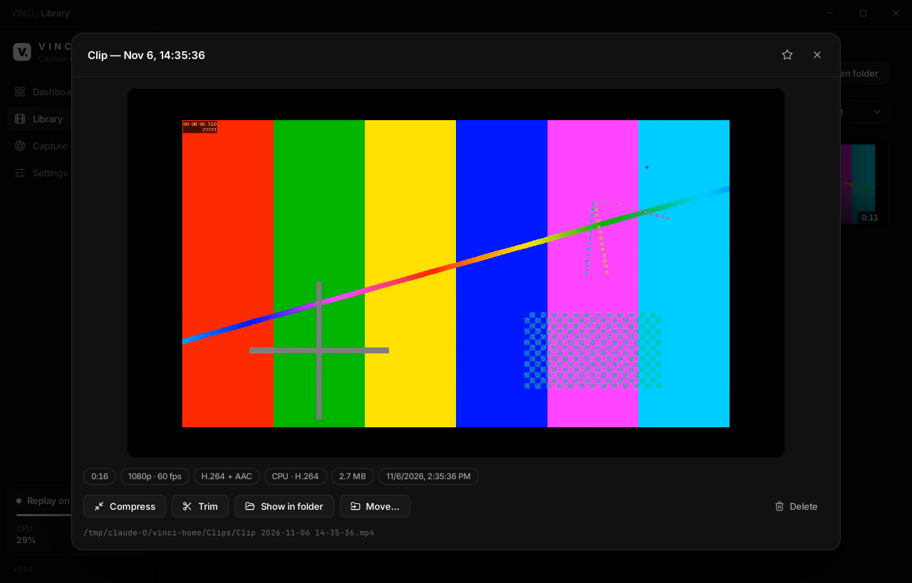

<div align="center">


# VINCI

**Capture Every Moment.**

A lightweight instant-replay recorder for gamers — Windows & Linux.
GPU-encoded replay buffer, one-key clips, no re-encoding, no account, no cloud.

[Install](#install) · [Features](#features) · [Build from source](#build-from-source) · [Troubleshooting](#troubleshooting) · [Français](README.fr.md)

</div>

---

## Install

**Linux** (Ubuntu, Debian, Mint, Pop!_OS, Fedora, openSUSE, Arch…):

```bash
curl -fsSL https://github.com/USERNAME/vinci/releases/latest/download/install.sh | bash
```

**Windows 10 / 11** (PowerShell, no admin rights needed):

```powershell
irm https://github.com/USERNAME/vinci/releases/latest/download/install.ps1 | iex
```

> `USERNAME/vinci` is a placeholder until the repository is published — maintainers run
> `scripts/configure-project.sh <owner>/<repo>`. Once a custom domain is attached to the
> install site (see [docs/RELEASING.md](docs/RELEASING.md)), the short form works too:
> `curl -fsSL https://<your-domain>/install.sh | bash` and `irm https://<your-domain>/install.ps1 | iex`
> (for example `vinci.app`, once that domain is configured).

Both scripts verify every download (SHA-256, plus an Ed25519 signature of the checksum
list and Authenticode when configured) before anything runs. Classic installers are on the
[Releases page](https://github.com/USERNAME/vinci/releases): `VINCI-windows-x64-setup.exe`,
`.msi`, `.deb`, `.rpm`, `.AppImage`. Details: [installers/README.md](installers/README.md).

Default hotkey: **Alt+F10** saves the last 30 seconds. Clips go to `Videos/VINCI`.

## Screenshots

| Dashboard | Library |
|---|---|
|  |  |
| **Capture** | **Player** |
|  |  |

*Real screenshots of VINCI running on Linux (virtual X11 desktop, CPU encoding — the
"x264 (CPU)" notice is VINCI honestly reporting that this test machine has no GPU encoder).*

## Why VINCI

| | |
|---|---|
| **LIGHTWEIGHT** | The engine is a ~12 MB native process using < 1 % CPU; capture and encoding run on the GPU's video engine. The interface process is closed when VINCI sits in the tray. 8 MB Linux packages. |
| **QUALITY** | HEVC / AV1 hardware encoding with quality-targeted rate control (CQ / ICQ / CRF) — sharp motion at a fraction of typical H.264 bitrates. Three profiles: Quality, Balanced, Compact. |
| **INSTANT** | Save the last 30 s, 1, 2, 3 or 5 minutes (up to 10) with one key. Clips are cut from the already-encoded buffer — no re-encoding, saved in about a second. |
| **SIMPLE** | One command to install, no account, no cloud, no telemetry. |

## Features

**Instant replay**
- Rolling buffer from 15 s to 10 min, in RAM or in a fixed-size disk ring (≈ 0 RAM), chosen automatically.
- Save 30 s / 1 m / 2 m / 3 m / 5 m from the dashboard, the tray, a hotkey per length, or `vinci --save-clip 60`.
- The clip includes the moment you pressed the key; cut on keyframes, never re-encoded.
- Crash-safe: atomic writes, the encoder is supervised and restarted, already buffered footage survives a restart, corrupted temporary files are cleaned at startup.

**Capture** — native APIs, no injection (anti-cheat safe)
- Windows: **Windows.Graphics.Capture** (monitor or game window) and **DXGI Desktop Duplication** (exclusive fullscreen); frames stay on the GPU (D3D11 → NVENC/AMF zero-copy, QSV via D3D11 interop).
- Linux: **X11** (XShm) and **Wayland** through **xdg-desktop-portal + PipeWire** (screen chosen once, remembered).
- Game audio + microphone (WASAPI loopback on Windows, PulseAudio/PipeWire on Linux), per-source volume.

**Encoding & compression**
- H.264, HEVC, AV1 on **NVIDIA NVENC, AMD AMF, Intel Quick Sync, VA-API**; every encoder is validated with a real test encode on your PC; automatic fallback (and CPU x264 as last resort).
- 720p / 1080p / 1440p / 4K (never upscales), 30 / 60 / 120 / 144 fps.
- Compress any clip in place: "Discord 10 MB", "50 MB", "Compact AV1/HEVC", 1080p downscale — still one file.
- Lossless trim.

**Library**
- One physical file per clip in your folder (optionally one sub-folder per game); SQLite only stores metadata.
- Thumbnails, built-in player with seeking, search, game filter, favourites, sort (date, size, length, name), rename (renames the file), move, delete, show in folder. Files added or removed outside VINCI are picked up.

**And also**
- Game detection (≈ 85 games + Steam/Epic/Riot/GOG libraries, Proton-aware): clips are named and filed per game; optional "only buffer while a game runs".
- Discreet in-game overlay ("Clip saved · 30 s"), configurable corner and opacity.
- Live CPU / RAM / GPU / encoder usage.
- Resource saver mode, capture priority, RAM budget.
- Signed automatic updates (stable / beta) that never touch your clips or settings.
- Headless CLI (`vinci-cli`) running the same engine.

## How it works

```
 Native capture (WGC / DDA / X11 / PipeWire)
        │  frames stay on the GPU
        ▼
 Hardware encoder (NVENC / AMF / QSV / VA-API) ──► fragmented MP4 stream
        │
        ▼
 VINCI replay buffer — GOP-aligned ring (RAM or disk), last N seconds
        │  hotkey
        ▼
 Copy the selected fragments → remux (-c copy, faststart) → atomic rename → library
```

Rust engine (independent crates) + Tauri 2 shell + React/TypeScript UI. FFmpeg/GStreamer run
as supervised helper processes. Full design: [docs/ARCHITECTURE.md](docs/ARCHITECTURE.md).

## Compatibility

| | Status |
|---|---|
| Windows 11, Windows 10 1903+ (x64) | Supported — WGC + DDA, NVENC / AMF / QSV. 1809 works with DDA only. ARM64 runs the x64 build under emulation. |
| Ubuntu 22.04+, Debian 12+, Mint 21+, Pop!_OS | Supported (`.deb`, X11 and Wayland) |
| Fedora 39+, openSUSE | Supported (`.rpm`). For H.264/HEVC hardware encoding on Fedora, use RPM Fusion's `ffmpeg` |
| Arch / Manjaro / EndeavourOS / others | Supported (AppImage, installer handles dependencies) |
| GPUs | NVIDIA (GTX 900+; AV1 needs RTX 40), AMD (VCN; AV1 needs RX 7000), Intel (Quick Sync / VA-API; AV1 needs Arc / Core Ultra). Without a GPU encoder VINCI falls back to CPU x264. |

What was verified, and how: [docs/TESTING.md](docs/TESTING.md).

## Configuration

Everything is in the app (**Capture** and **Settings**). Files, if you need them:

| | Linux | Windows |
|---|---|---|
| Settings | `~/.config/vinci/settings.json` | `%APPDATA%\VINCI\config\settings.json` |
| Library index, logs | `~/.local/share/vinci/` | `%LOCALAPPDATA%\VINCI\data\` |
| Thumbnails, replay ring | `~/.cache/vinci/` | `%LOCALAPPDATA%\VINCI\cache\` |
| Clips | `~/Videos/VINCI` | `Videos\VINCI` |

Command line (also usable from desktop shortcuts or compositor key bindings):

```bash
vinci --save-clip          # save the default length
vinci --save-clip 120      # save the last 2 minutes
vinci --toggle-replay      # start/stop the buffer
vinci --minimized          # start in the tray
```

**Wayland:** VINCI registers its hotkeys through the XDG GlobalShortcuts portal (KDE Plasma,
GNOME 48+, Hyprland…). On desktops without it, bind `vinci --save-clip` to a key in your
desktop's keyboard settings.

## Build from source

```bash
git clone https://github.com/USERNAME/vinci.git
cd vinci
```

### Linux (Ubuntu/Debian)

```bash
sudo apt install -y build-essential curl libwebkit2gtk-4.1-dev libayatana-appindicator3-dev \
  librsvg2-dev libxdo-dev libssl-dev patchelf ffmpeg gstreamer1.0-plugins-good \
  gstreamer1.0-libav gstreamer1.0-pipewire
```

Fedora: `sudo dnf install webkit2gtk4.1-devel libappindicator-gtk3-devel librsvg2-devel libxdo-devel openssl-devel ffmpeg-free gstreamer1-plugins-good pipewire-gstreamer`
· Arch: `sudo pacman -S --needed webkit2gtk-4.1 libappindicator-gtk3 librsvg xdotool openssl ffmpeg gst-plugins-good gst-libav gst-plugin-pipewire base-devel`

Install Rust (https://rustup.rs) and Node.js 20+, then:

```bash
npm ci
npm run tauri dev                  # development (hot reload)
npm run tauri build                # production: .deb, .rpm, .AppImage in target/release/bundle/
cargo test --workspace             # 70+ tests, incl. real FFmpeg encodes
scripts/e2e-linux.sh               # end-to-end on a virtual X11 desktop (needs Xvfb, pulseaudio, xdotool)
cargo run -p vinci-cli -- detect   # headless: hardware & encoder report
```

### Windows

Install [Rust](https://rustup.rs) (MSVC toolchain), [Node.js 20+](https://nodejs.org),
Visual Studio Build Tools ("Desktop development with C++") and WebView2 (preinstalled on Windows 11). Then in PowerShell:

```powershell
npm ci
powershell -ExecutionPolicy Bypass -File scripts\fetch-ffmpeg.ps1   # bundled FFmpeg 8.1 (WGC support)
npm run tauri dev
npm run tauri build      # NSIS setup.exe + MSI in target\release\bundle\
cargo test --workspace
```

## Troubleshooting

| Problem | Fix |
|---|---|
| "Using x264 (CPU) — encoder not available" | Your GPU encoder failed its test encode. Update the GPU driver; on Linux check `/dev/dri/renderD*` access (`sudo usermod -aG render,video $USER`, then re-login) and install the VA-API driver (`intel-media-va-driver`, `mesa-va-drivers`). **Settings → Diagnostics** shows each encoder's error. |
| Wayland: "Wayland capture needs GStreamer with the PipeWire plugin" | Install `gstreamer1.0-pipewire` (Debian/Ubuntu), `pipewire-gstreamer` (Fedora) or `gst-plugin-pipewire` (Arch), plus `xdg-desktop-portal` for your desktop. |
| Hotkey does nothing | Another app may own it (shown in **Settings → Hotkeys**) — pick another. On Wayland without the GlobalShortcuts portal, bind `vinci --save-clip` in your desktop settings. |
| Fullscreen game not captured on Windows | Switch **Capture method** to *Desktop Duplication* (captures exclusive fullscreen), or play borderless. |
| No sound in clips | Check **Capture → Audio** (output device). Linux: `pactl list short sources` must show a `.monitor` source. Adjust **Settings → Advanced → Audio offset** if out of sync. |
| Clip doesn't play in VINCI | Use "Open in player". HEVC/AV1 playback inside the app depends on the system web view (Windows needs the HEVC/AV1 Video Extensions). |
| AppImage won't start | Install FUSE 2 (`libfuse2t64` on Ubuntu 24.04, `fuse-libs` on Fedora, `fuse2` on Arch). |
| Anything else | **Settings → Advanced → Open logs folder** (`vinci.log`) and **Diagnostics → Copy report**. |

## Privacy & security

No account, no telemetry, no cloud. The only network request is the optional daily
update check, and updates are installed only if their Ed25519 signature and SHA-256 match.
The replay buffer lives in RAM or in a temporary file deleted on exit. VINCI never injects
code into games.

## Project layout

```
crates/            Rust engine — one crate per module
  vinci-hw/        hardware & capability detection
  vinci-capture/   capture backends (WGC, DDA, X11, PipeWire), WASAPI
  vinci-encoding/  encoders, profiles, probing, compression
  vinci-replay/    fMP4 ring buffer & zero-re-encode export
  vinci-clips/     SQLite library
  vinci-storage/   paths, atomic persistence
  vinci-games/     game detection
  vinci-hotkeys/   global hotkeys
  vinci-update/    signed updates + release signing tool
  vinci-engine/    orchestration (used by the app and the CLI)
  vinci-cli/       headless CLI
src-tauri/         desktop shell (Tauri 2): windows, tray, overlay, media server
src/               React + TypeScript UI (components, pages, hooks, styles)
installers/        install.sh, install.ps1, uninstall.ps1
scripts/           release, packaging, test and setup scripts
docs/              architecture, testing, releasing
.github/workflows/ CI, release, version bump, install site
```

## Contributing & releases

Pull requests welcome — run `cargo fmt`, `cargo clippy --workspace -- -D warnings`,
`cargo test --workspace` and `npm test`. Maintainers: see [docs/RELEASING.md](docs/RELEASING.md)
(signing keys, stable/beta channels, one-click version bump).

## License

[MIT](LICENSE). The Windows installer and the AppImage bundle FFmpeg (GPL v3 build) as a
separate program — see [THIRD_PARTY_NOTICES.md](THIRD_PARTY_NOTICES.md).
